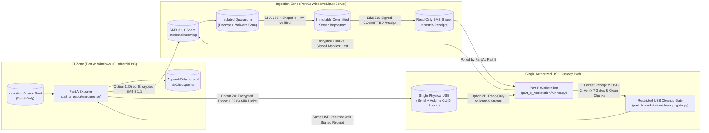
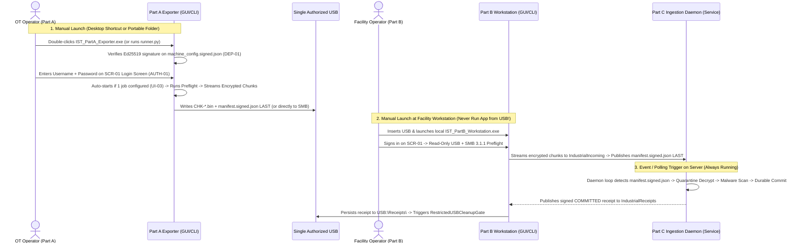

# Industrial Secure Data Transfer — Architecture, Capabilities & Resilience Guide

**Document Version:** 1.2.0  
**Scope:** Part A (Windows 10 Industrial PC Exporter), Part B (Facility Transfer Workstation), Part C (Ingestion Server Service)  
**Safety Classification:** Strictly Non-Destructive (`SAF-01`, `SAF-02`, `SAF-03`) & Defense-in-Depth Cryptographic Transport (`SEC-01`, `RES-01`, `SRV-01`..`SRV-03`)

---

## 1. Executive Summary: What the Codebase Is Capable of Doing Today

The repository in [`industrial_secure_transfer/`](file:///c:/Users/LENOVO/OneDrive%20-%20BizTranSights%20Solutions,%20LLP/Industrial-Data-Transfer/industrial_secure_transfer/__init__.py) is a **complete, runnable, modular production-grade Python system** engineered for Operational Technology (OT) and industrial environments. Rather than a monolithic script, it separates a shared cryptographic and safety engine (`core/`) from OS-specific hardware/network adapters (`adapters/`), transport layers (`transports/`), and three isolated role deliverables:



---

## 2. How SMB & USB Connection Disruptions Are Handled (AWS DataSync-Style Checkpoint & Delta Resume)

A critical requirement in industrial facilities (wired OT VLANs or approved enterprise Wi-Fi) is that **network drops, SMB session timeouts, power interruptions, or accidental USB disconnects must NEVER force a multi-gigabyte transfer to restart from scratch**, and must **NEVER overwrite or corrupt existing files**.

Our implementation achieves **AWS DataSync-style resumable transfer semantics** across four coordinated layers:

### Layer 1: Independent 32 MiB Authenticated Chunks (No Monolithic Local ZIP)
- In [`core/packaging.py`](file:///c:/Users/LENOVO/OneDrive%20-%20BizTranSights%20Solutions,%20LLP/Industrial-Data-Transfer/industrial_secure_transfer/core/packaging.py), [`StreamingPackager`](file:///c:/Users/LENOVO/OneDrive%20-%20BizTranSights%20Solutions,%20LLP/Industrial-Data-Transfer/industrial_secure_transfer/core/packaging.py#L179-L361) slices datasets into independent bounded-memory chunks (`CHK-000000.bin`, `CHK-000001.bin`, …; default **32 MiB**, configurable up to 64 MiB).
- Each chunk is independently compressed (`zlib` or `none`) and encrypted with **AES-256-GCM** using a deterministic index-bound 96-bit nonce (`NonceGenerator.next_nonce(explicit_index=chunk_index)`) and structured **Additional Authenticated Data (`ChunkAAD`)**.
- Because there is no monolithic temporary ZIP file on disk, interrupting a 25 GB transfer at 90% completion leaves the first 90% of chunks independently verifiable and cryptographically complete on the destination.

### Layer 2: In-Flight Transient Disconnect Auto-Retry with Backoff (`2s -> 5s -> 10s`)
- In [`transports/smb_transport.py`](file:///c:/Users/LENOVO/OneDrive%20-%20BizTranSights%20Solutions,%20LLP/Industrial-Data-Transfer/industrial_secure_transfer/transports/smb_transport.py), [`SMBTransport.write_and_verify_chunk_resilient()`](file:///c:/Users/LENOVO/OneDrive%20-%20BizTranSights%20Solutions,%20LLP/Industrial-Data-Transfer/industrial_secure_transfer/transports/smb_transport.py#L226-L298) wraps every chunk transmission in a bounded retry state machine (`DEFAULT_RETRY_BACKOFF_SECONDS = (2.0, 5.0, 10.0)`):
  1. **Immediate ETA Stall Signal:** On a socket timeout or SMB drop, it immediately marks the [`RollingETACalculator`](file:///c:/Users/LENOVO/OneDrive%20-%20BizTranSights%20Solutions,%20LLP/Industrial-Data-Transfer/industrial_secure_transfer/core/eta.py#L26-L185) as disconnected (`eta_calc.set_disconnected(True)`), so the UI displays `ETA: Unavailable` instead of a false countdown (`UI-06`), and logs an immutable `SMB_TRANSIENT_DISCONNECT_RETRY` event to the audit journal.
  2. **Post-Reconnect SMB 3.1.1 Security Re-Verification (`NET-01`):** When the backoff timer expires and the connection comes back, it re-runs `run_preflight()` before sending a single byte — confirming that the reconnected session did not downgrade to an unencrypted link, SMB1/2, or an unauthorized server.
  3. **Idempotent Read-Back Check Before Re-Sending:** If the drop occurred *after* the bytes reached the server but *before* the acknowledgment returned, `check_existing_chunk_on_destination()` reads back and hashes the file on the SMB share. If the chunk is already intact (`size == cipher_size` and `SHA-256 == cipher_sha256`), it marks the chunk verified without re-transmitting it.

### Layer 3: Durable Append-Only Checkpointing & Exact-Chunk Delta Resume
- In [`core/state.py`](file:///c:/Users/LENOVO/OneDrive%20-%20BizTranSights%20Solutions,%20LLP/Industrial-Data-Transfer/industrial_secure_transfer/core/state.py), [`AppendOnlyJournal.record_chunk_checkpoint()`](file:///c:/Users/LENOVO/OneDrive%20-%20BizTranSights%20Solutions,%20LLP/Industrial-Data-Transfer/industrial_secure_transfer/core/state.py#L244-L261) writes a hash-chained checkpoint segment (`SEG-<seq>-<id>.json`) to local storage **ONLY AFTER** the destination (SMB share or USB volume) has flushed (`os.fsync`) and passed a full read-back SHA-256 verification.
- If the network stays down longer than the in-flight backoff window, or if the PC loses power or the operator clicks **Pause** / **Stop Safely**:
  - When the transfer is resumed (via [`PartAExporterRunner.execute_export()`](file:///c:/Users/LENOVO/OneDrive%20-%20BizTranSights%20Solutions,%20LLP/Industrial-Data-Transfer/industrial_secure_transfer/part_a_exporter/runner.py#L173-L452) or [`PartBWorkstationRunner.execute_usb_to_smb_transfer()`](file:///c:/Users/LENOVO/OneDrive%20-%20BizTranSights%20Solutions,%20LLP/Industrial-Data-Transfer/industrial_secure_transfer/part_b_workstation/runner.py#L129-L337)), the runner queries `self._journal.get_verified_chunks(transfer_id, attempt_id)`.
  - **Destination Reconciliation (Never Trust Local State Alone):** For every checkpointed chunk index $0 \dots k$, the runner calls `smb_tx.check_existing_chunk_on_destination()` (or `usb_tx.check_existing_chunk_on_usb()`) to confirm the file on the remote share/USB still exists and matches its exact `cipher_size` and `cipher_sha256`.
  - **Skip Verified Chunks (`skip_chunk_indices`):** All intact verified chunks are added to `skip_indices`. `StreamingPackager.stream_encrypted_chunks()` still verifies that the local source files have not mutated (`DAT-01`), records the existing verified chunk metadata into the final manifest list, and **skips re-encrypting and re-uploading those chunks**, resuming network I/O at chunk $k+1$.

### Layer 4: File-Level Incremental Deduplication Across Daily Runs (DataSync Delta Sync)
- Once a transfer completes and Part A verifies the server's signed `COMMITTED` receipt, [`AppendOnlyJournal.record_acknowledged_files()`](file:///c:/Users/LENOVO/OneDrive%20-%20BizTranSights%20Solutions,%20LLP/Industrial-Data-Transfer/industrial_secure_transfer/core/state.py#L290-L309) records the `device_id + relative_path -> SHA-256` mapping in the local journal.
- On the next run in default `INCREMENTAL` mode, [`discover_and_freeze_dataset()`](file:///c:/Users/LENOVO/OneDrive%20-%20BizTranSights%20Solutions,%20LLP/Industrial-Data-Transfer/industrial_secure_transfer/core/discovery.py#L106-L273) compares each file's actual content SHA-256 against `acknowledged_hashes`. Unchanged files are recorded in `skipped_unchanged_files` and never re-transferred; only newly created or modified files are packaged.

---

## 3. Detailed Module-by-Module Capability Breakdown

### 3.1 Shared Core (`industrial_secure_transfer/core/`)

| Module | File Link | What It Implements & Enforces |
| :--- | :--- | :--- |
| **Non-Destructive Safety & Path Confinement** | [`core/safety.py`](file:///c:/Users/LENOVO/OneDrive%20-%20BizTranSights%20Solutions,%20LLP/Industrial-Data-Transfer/industrial_secure_transfer/core/safety.py) | • **Create-Only Writes (`SAF-01`):** `create_only_open()` and `create_only_write_bytes()` use exclusive creation (`"xb"` / `CREATE_NEW`) + `os.fsync()`. Any collision raises `FileCollisionError` without modifying existing data.<br>• **Path Confinement:** `validate_confined_path()` and `validate_relative_path()` walk every path component and reject `..` traversal, symlinks, Windows junctions/reparse points (`FILE_ATTRIBUTE_REPARSE_POINT`), Alternate Data Streams (`file.txt:ads`), NT device paths (`\\.\`, `\\?\`), Windows reserved device names (`CON`, `NUL`, `AUX`, `COM1`..`LPT9`), multiple hardlinks (`st_nlink > 1`), non-NFC Unicode, and case-insensitive path collisions (`detect_case_collisions()`). |
| **Defense-in-Depth Cryptography** | [`core/crypto.py`](file:///c:/Users/LENOVO/OneDrive%20-%20BizTranSights%20Solutions,%20LLP/Industrial-Data-Transfer/industrial_secure_transfer/core/crypto.py) | • **AES-256-GCM (`SEC-01`):** Per-chunk authenticated encryption (`encrypt_chunk_aes_gcm`, `decrypt_chunk_aes_gcm`) with 12-byte unique nonces (`NonceGenerator`) and 16-byte authentication tags.<br>• **Structured AAD (`ChunkAAD`):** Binds `version`, `transferId`, `attemptId`, `packageId`, `chunkIndex`, `codec`, `plainSize`, and `uncompressedSize` to the GCM tag so chunks cannot be reordered or spliced across transfers.<br>• **RSA-OAEP (SHA-256, 3072-bit+):** Wraps the random 256-bit per-transfer DEK with the server's public key (`wrap_dek_rsa_oaep`, `unwrap_dek_rsa_oaep`).<br>• **Ed25519 Digital Signatures:** Domain-separated canonical JSON signing and verification (`sign_canonical_document`, `verify_canonical_document`) and strict JSON parsing (`parse_strict_json`) that rejects duplicate keys or `NaN`/`Infinity`. |
| **Signed Configuration Loader** | [`core/config.py`](file:///c:/Users/LENOVO/OneDrive%20-%20BizTranSights%20Solutions,%20LLP/Industrial-Data-Transfer/industrial_secure_transfer/core/config.py) | • **Provisioning Signature Check (`DEP-01`):** Verifies the Ed25519 signature (`IST-CONFIG-V1`) over the machine config JSON before trusting any field.<br>• **Zero Override Invariant (`SAF-02`):** Recursively scans and rejects any config containing forbidden bypass keys (`bypass_preflight`, `allow_unencrypted`, `allow_overwrite`, `force_cleanup`, etc.).<br>• **Trust Boundary Enforcement:** Blocks Part A and Part B configs from ever containing `recipient_rsa_private_key_pem` or `server_signing_private_key_pem`. |
| **Bounded-Memory Streaming Packager** | [`core/packaging.py`](file:///c:/Users/LENOVO/OneDrive%20-%20BizTranSights%20Solutions,%20LLP/Industrial-Data-Transfer/industrial_secure_transfer/core/packaging.py) | • **Bounded Streaming:** Slices files into 32 MiB chunks in memory without creating a local temporary archive.<br>• **Format-Aware Lossless Compression:** Compresses CSV, JSON, XML, and text slices with `zlib` (retaining compressed bytes only when `< 98%` of raw size) and skips pre-compressed formats (`.jpg`, `.jpeg`, `.png`, `.laz`, `.zip`, `.mp4`, `.gz`, `.7z`, `.zst`).<br>• **Encrypted Inner Manifest:** Encrypts file relative paths, sizes, timestamps, SHA-256 digests, and chunk mappings inside `encryptedManifest` using AES-256-GCM so intermediate nodes only see opaque chunk IDs.<br>• **Decompression Bomb Protection:** `decompress_slice_bounded()` enforces strict max chunk output size and expansion ratio quotas (`max_ratio=100.0`). |
| **Daily Dataset Discovery & Geospatial Rules** | [`core/discovery.py`](file:///c:/Users/LENOVO/OneDrive%20-%20BizTranSights%20Solutions,%20LLP/Industrial-Data-Transfer/industrial_secure_transfer/core/discovery.py) | • **Frozen Inventory (`DAT-01`, `DAT-02`):** Scans the approved source root in read-only mode, checks for `_DATASET_READY.marker`, and supports `INCREMENTAL`, `FULL_DAILY`, `DATE_RANGE`, and `RETRY` modes.<br>• **Shapefile Companion Grouping:** Automatically groups `.shp`, `.shx`, `.dbf`, and `.prj` (plus `.cpg`, `.qpj`, `.sbn`, `.sbx`, `.shp.xml`). If any required companion is missing or actively being written, the entire group is deferred with an explicit reason.<br>• **Active-Write Deferral & Live Mutation Detection:** Defers files modified within `stability_window_seconds` and verifies `size` and `mtime_utc_ns` before, during, and after reading (`verify_frozen_file_unchanged`). |
| **Immutable Checkpoint & Audit Journal** | [`core/state.py`](file:///c:/Users/LENOVO/OneDrive%20-%20BizTranSights%20Solutions,%20LLP/Industrial-Data-Transfer/industrial_secure_transfer/core/state.py) | • **Hash-Chained Segment Files (`RES-01`, `AUD-01`):** Writes each state transition, chunk checkpoint, acknowledged file map, and audit event as a create-only segment (`SEG-00000001-<id>.json`) linked by `prev_record_hash -> record_hash`.<br>• **Tamper Detection & Secret Scrubbing:** Verifies the entire hash chain on startup (`JournalIntegrityError` on tamper) and rejects any payload containing secret keys (`password`, `dek`, `private_key`, `plaintext`). |
| **Rolling Verified Throughput ETA** | [`core/eta.py`](file:///c:/Users/LENOVO/OneDrive%20-%20BizTranSights%20Solutions,%20LLP/Industrial-Data-Transfer/industrial_secure_transfer/core/eta.py) | • **15–30s Sliding Window (`UI-06`, `PERF-01`):** Computes throughput and remaining time strictly from read-back verified bytes over a 15–30s rolling window.<br>• **Fail-Safe Display:** Immediately returns `"Unavailable"` when paused, disconnected, stalled beyond threshold, or with `< 2` samples, and caps progress at `99.9%` until final manifest/receipt verification completes. |
| **Operator Authentication** | [`core/auth.py`](file:///c:/Users/LENOVO/OneDrive%20-%20BizTranSights%20Solutions,%20LLP/Industrial-Data-Transfer/industrial_secure_transfer/core/auth.py) | • **Salted Argon2id Verification (`AUTH-01`, `UI-01`):** Verifies operator credentials in constant time, enforces minimum inter-attempt intervals, locks accounts after consecutive failed attempts, enforces idle and absolute session expiration, and never logs passwords. |

---

### 3.2 OS Adapters (`industrial_secure_transfer/adapters/`) & Transports (`industrial_secure_transfer/transports/`)

| Component | File Link | What It Implements & Enforces |
| :--- | :--- | :--- |
| **Abstract OS Adapter Contract** | [`adapters/base.py`](file:///c:/Users/LENOVO/OneDrive%20-%20BizTranSights%20Solutions,%20LLP/Industrial-Data-Transfer/industrial_secure_transfer/adapters/base.py) | • Enforces cross-platform USB preflight rules (`validate_authorized_usb`: non-system disk, removable USB bus, serial number + volume GUID match, expected NTFS/exFAT filesystem, dirty-bit rejection, SMART health check, and tolerance of `UNAVAILABLE` optional telemetry per `USB-03`).<br>• Enforces SMB session rules (`validate_smb_policy`: remote mount verification, server identity match, SMB 3.1.1 dialect enforcement, SMB 1/2 prohibition, and transport encryption/signing verification per `NET-01`, `NET-02`). |
| **Windows 10 / Server Adapter** | [`adapters/windows.py`](file:///c:/Users/LENOVO/OneDrive%20-%20BizTranSights%20Solutions,%20LLP/Industrial-Data-Transfer/industrial_secure_transfer/adapters/windows.py) | • Queries Win32 `kernel32` (`GetDriveTypeW`, `GetVolumeInformationW`, `GetVolumeNameForVolumeMountPointW`), read-only `fsutil dirty query <X:>` (never invoking `chkdsk` repair), physical USB bus/serial via `Get-Partition`/`Get-Disk`, and live SMB 3.1.1 dialect/encryption status via `Get-SmbConnection`. |
| **Linux Workstation / Server Adapter** | [`adapters/linux.py`](file:///c:/Users/LENOVO/OneDrive%20-%20BizTranSights%20Solutions,%20LLP/Industrial-Data-Transfer/industrial_secure_transfer/adapters/linux.py) | • Queries `lsblk -J -o NAME,UUID,SERIAL,TRAN,FSTYPE,RM,MOUNTPOINT` for USB bus and hardware serial verification, parses `/proc/mounts` to confirm target shares are genuine mounted `smb3`/`cifs` shares with `vers=3.1.1` and `seal` encryption (rejecting unmounted local directories), and checks POSIX directory permissions. |
| **SMB 3.1.1 Streaming Transport** | [`transports/smb_transport.py`](file:///c:/Users/LENOVO/OneDrive%20-%20BizTranSights%20Solutions,%20LLP/Industrial-Data-Transfer/industrial_secure_transfer/transports/smb_transport.py) | • Create-only chunk streaming to `IndustrialIncoming/<transferId>/<attemptId>/`, immediate read-back SHA-256 verification, resilient auto-reconnect retry (`write_and_verify_chunk_resilient`), final manifest publication last (`manifest.signed.json`), and read-only polling + Ed25519 verification of server receipts from `IndustrialReceipts`. |
| **Single-USB Export/Import Transport** | [`transports/usb_transport.py`](file:///c:/Users/LENOVO/OneDrive%20-%20BizTranSights%20Solutions,%20LLP/Industrial-Data-Transfer/industrial_secure_transfer/transports/usb_transport.py) | • Enforces the standard USB folder hierarchy (`Application\`, `Configuration\`, `Certificates\`, `Transfers\`, `Diagnostics\`, `Receipts\`, `Logs\`) and scans for unexpected root files or unauthorized executables.<br>• **Export Health Probe (`USB-01`..`USB-04`):** Writes a 32–64 MiB random diagnostic file (`USB:\Diagnostics\PROBE-*.bin`) strictly on the USB volume, flushes, re-opens, and verifies its SHA-256 within the timeout.<br>• **Custody Verification:** Verifies returned signed `COMMITTED` receipts on the USB before unlocking the next strict-mode export. Contains **zero** file deletion methods (`SAF-03`). |

---

### 3.3 Role-Specific Deliverables, UI & Build Specs

1. **Part A — Exporter ([`part_a_exporter/runner.py`](file:///c:/Users/LENOVO/OneDrive%20-%20BizTranSights%20Solutions,%20LLP/Industrial-Data-Transfer/industrial_secure_transfer/part_a_exporter/runner.py)):**
   - Runs on the Windows 10 Industrial PC.
   - Contains a hard runtime assertion (`_assert_no_cleanup_module_loaded()`) and AST test verification guaranteeing that `cleanup_gate` is never imported or bundled (`SAF-03`).
   - Orchestrates direct SMB exports, single-USB exports, checkpoint resume, safe pause/stop at chunk boundaries, and returned USB receipt acknowledgment.
2. **Part B — Transfer Workstation ([`part_b_workstation/runner.py`](file:///c:/Users/LENOVO/OneDrive%20-%20BizTranSights%20Solutions,%20LLP/Industrial-Data-Transfer/industrial_secure_transfer/part_b_workstation/runner.py)) & Restricted USB Cleanup Gate ([`part_b_workstation/cleanup_gate.py`](file:///c:/Users/LENOVO/OneDrive%20-%20BizTranSights%20Solutions,%20LLP/Industrial-Data-Transfer/industrial_secure_transfer/part_b_workstation/cleanup_gate.py)):**
   - Runs on the facility workstation (Windows or Linux).
   - Validates the USB package in read-only mode, streams encrypted chunks directly from USB to SMB with resilient auto-retry and checkpointing, polls for the signed `COMMITTED` receipt, and writes the receipt to `USB:\Receipts\<transferId>.receipt.json`.
   - Invokes `RestrictedUSBCleanupGate.execute_authorized_cleanup()`, which enforces **7 mandatory sequential hardware and cryptographic gates** (including re-verifying the physical USB serial + volume GUID immediately before **each** individual `os.unlink()` call to defeat TOCTOU device-swap attacks) and deletes only exact manifest-listed chunks and `PROBE-*.bin` files while preserving `Receipts\`, `Application\`, `Configuration\`, `Certificates\`, and `Logs\`.
3. **Part C — Ingestion Server Service ([`part_c_server/ingestion_svc.py`](file:///c:/Users/LENOVO/OneDrive%20-%20BizTranSights%20Solutions,%20LLP/Industrial-Data-Transfer/industrial_secure_transfer/part_c_server/ingestion_svc.py)):**
   - Watches and reconciles `IndustrialIncoming` for completed `manifest.signed.json` packages (ignoring partial in-progress uploads).
   - Enforces idempotent deduplication (`senderId + transferId + manifestHash` — `SRV-03`), verifies outer signatures and ciphertext hashes, unwraps the DEK with the server-only RSA private key, and decrypts/decompresses strictly inside an isolated quarantine directory (`SRV-01`).
   - Enforces decompression-bomb quotas, runs the pluggable `malware_scan_hook` on quarantined plaintext, verifies original file SHA-256 digests and shapefile companion completeness, performs a create-only durable immutable commit to `committed_repository_dir/<senderId>/<datasetId>/<commitId>/` with read-back verification, and only then signs and publishes the `COMMITTED` receipt (`SRV-02`).
4. **Responsive Desktop Operator UI ([`ui/desktop_app.py`](file:///c:/Users/LENOVO/OneDrive%20-%20BizTranSights%20Solutions,%20LLP/Industrial-Data-Transfer/industrial_secure_transfer/ui/desktop_app.py)):**
   - Separates thread-safe state and worker queue orchestration (`OperatorUIController`) from the Tkinter GUI (`IndustrialTransferDesktopApp`).
   - Implements login with show/hide password toggle (`SCR-01`), job selection or single-job auto-preflight (`SCR-02`, `UI-03`), preflight checklist distinguishing `Passed`, `Failed`, `Pending`, and `Unavailable` optional telemetry (`SCR-03`, `UI-02`), progress/rolling ETA (`SCR-04`), safe `Pause`, `Resume`, and `Stop Safely` buttons (never offering *Cancel & Delete* or safety overrides — `UI-05`, `SAF-02`), and read-only transfer history & receipt inspection (`SCR-19`, `SCR-20`).
5. **PyInstaller `onedir` Build Specs ([`part_a_exporter.spec`](file:///c:/Users/LENOVO/OneDrive%20-%20BizTranSights%20Solutions,%20LLP/Industrial-Data-Transfer/industrial_secure_transfer/build/pyinstaller_specs/part_a_exporter.spec), [`part_b_workstation.spec`](file:///c:/Users/LENOVO/OneDrive%20-%20BizTranSights%20Solutions,%20LLP/Industrial-Data-Transfer/industrial_secure_transfer/build/pyinstaller_specs/part_b_workstation.spec)):**
   - Package Part A and Part B as `onedir` distributions with `uac_admin=False` (`DEP-02`) and explicit build-time exclusion of `cleanup_gate` and `part_c_server` from Part A (`SAF-03`).

---

## 4. How the Scripts & Deliverables Trigger (Execution Model)

Because of mandatory OT safety requirement **`DEP-02`** (*"No autorun, automatic Internet updates, or privilege elevation"*) and **`Scope Section 02`** (*"manual, operator-authenticated transfer... no automatic scheduled exports unless separately approved"*), the three parts trigger in two distinct ways:
- **Part A and Part B are Operator-Triggered Desktop Executables** (never USB Autorun, never unauthenticated background cron jobs).
- **Part C is an Always-On Background Server Daemon/Service** that triggers automatically whenever a final signed manifest lands in `IndustrialIncoming`.



### 4.1 Part A — Exporter Trigger (Windows 10 Industrial PC)
- **Why No USB Autorun?** Windows Autorun/AutoPlay on removable media is strictly prohibited by NIST SP 800-82 / SP 1334 and `DEP-02` to prevent BadUSB/malware auto-execution in the OT zone.
- **How It Starts:**
  1. The operator launches the PyInstaller `onedir` executable (`IST_PartA_Exporter\IST_PartA_Exporter.exe`) from the protected local folder (e.g., `C:\Program Files\IndustrialSecureTransfer\`) or invokes [`industrial_secure_transfer/part_a_exporter/runner.py`](file:///c:/Users/LENOVO/OneDrive%20-%20BizTranSights%20Solutions,%20LLP/Industrial-Data-Transfer/industrial_secure_transfer/part_a_exporter/runner.py#L455-L534):
     ```powershell
     IST_PartA_Exporter.exe --config-dir "C:\IST\Config" --usb-root "E:\"
     # Or via Python CLI:
     python -m industrial_secure_transfer.part_a_exporter.runner --config-dir "C:\IST\Config" --usb-root "E:\"
     ```
  2. **Pre-Launch Gate (`DEP-01`):** Before the UI opens, `main()` verifies the Ed25519 provisioning signature on `machine_config.signed.json`.
  3. **Login & Auto-Trigger (`UI-01`, `UI-03`):** The Tkinter login screen (`SCR-01`) appears. Once the operator signs in:
     - **Single-Job Auto-Trigger (`UI-03`):** If the signed machine configuration contains **exactly 1 job**, valid login **automatically triggers** the preflight checklist (`SCR-03`) and **immediately starts** the transfer (`SCR-04`) as soon as all mandatory preflight checks pass—requiring zero extra clicks.
     - **Multi-Job Selection (`SCR-02`):** If multiple jobs are configured (e.g., Option 1 Direct SMB vs. Option 2A Single USB), the UI presents the Job Selection screen (`SCR-02`) and triggers preflight + transfer as soon as the operator selects the job.

### 4.2 Part B — Transfer Workstation Trigger (Facility Workstation — Windows or Linux)
- **Security Rule (Section 22.6):** The operator at the facility workstation inserts the single authorized USB (`USB-003`), but **never** executes a binary directly off the untrusted USB. They always launch the locally installed Part B application.
- **How It Starts:**
  1. The operator launches `IST_PartB_Workstation\IST_PartB_Workstation.exe` (or runs [`industrial_secure_transfer/part_b_workstation/runner.py`](file:///c:/Users/LENOVO/OneDrive%20-%20BizTranSights%20Solutions,%20LLP/Industrial-Data-Transfer/industrial_secure_transfer/part_b_workstation/runner.py#L340-L420)):
     ```powershell
     IST_PartB_Workstation.exe --config-dir "C:\IST_Workstation\Config" --usb-root "E:\"
     # Or on Linux:
     python3 -m industrial_secure_transfer.part_b_workstation.runner --config-dir "/etc/ist/config" --usb-root "/mnt/usb003"
     ```
  2. After operator login (`SCR-01`), Part B automatically runs its read-only USB preflight + SMB 3.1.1 preflight (`SCR-10`), streams the encrypted chunks from the USB to `IndustrialIncoming`, polls `IndustrialReceipts` until Part C commits, writes the receipt to `USB:\Receipts\<transferId>.receipt.json`, and **automatically triggers** [`RestrictedUSBCleanupGate.execute_authorized_cleanup()`](file:///c:/Users/LENOVO/OneDrive%20-%20BizTranSights%20Solutions,%20LLP/Industrial-Data-Transfer/industrial_secure_transfer/part_b_workstation/cleanup_gate.py#L118-L280).

### 4.3 Part C — Ingestion Server Trigger (Windows Service / Linux `systemd` Daemon)
- **No Human Operator Needed:** Part C runs continuously in the background under a restricted service account (`IST_IngestionSvc`) via [`IngestionServerService.run_daemon_loop()`](file:///c:/Users/LENOVO/OneDrive%20-%20BizTranSights%20Solutions,%20LLP/Industrial-Data-Transfer/industrial_secure_transfer/part_c_server/ingestion_svc.py#L465-L539).
- **How It Starts & Triggers:**
  1. Started at server boot by Windows Service Control Manager (SCM) or Linux `systemd`:
     ```bash
     python3 -m industrial_secure_transfer.part_c_server.ingestion_svc \
         --config-dir "/etc/ist_server/config" \
         --poll-interval 2.0
     ```
  2. **Manifest-Triggered Ingestion:** Every `2.0` seconds (configurable), `scan_and_reconcile_incoming()` scans `IndustrialIncoming/<transferId>/<attemptId>/`.
     - While Part A or Part B is still uploading encrypted chunks (`CHK-000000.bin`, `CHK-000001.bin`, …), `manifest.signed.json` does not exist yet, so Part C ignores the in-progress folder.
     - The moment Part A or Part B publishes `manifest.signed.json` **last**, Part C's reconciliation loop automatically triggers validation, quarantine decryption, malware scanning, durable repository commit, and signed `COMMITTED` receipt publication to `IndustrialReceipts`.

---

## 5. Lab Verification & How to Run Right Now

Both the automated 12-suite verification test runner ([`industrial_secure_transfer/tests/test_suite.py`](file:///c:/Users/LENOVO/OneDrive%20-%20BizTranSights%20Solutions,%20LLP/Industrial-Data-Transfer/industrial_secure_transfer/tests/test_suite.py)) and the 7-stage end-to-end pipeline validator ([`validate_demo.py`](file:///c:/Users/LENOVO/OneDrive%20-%20BizTranSights%20Solutions,%20LLP/Industrial-Data-Transfer/validate_demo.py)) can be executed directly:

```powershell
# Run the automated unit, safety, checkpoint-resume, and adversarial test suite
& "C:\Program Files\Microsoft SDKs\Azure\CLI2\python.exe" "industrial_secure_transfer\tests\test_suite.py"

# Run the 7-stage end-to-end single-USB & server ingestion validation demo
& "C:\Program Files\Microsoft SDKs\Azure\CLI2\python.exe" "validate_demo.py"
```
